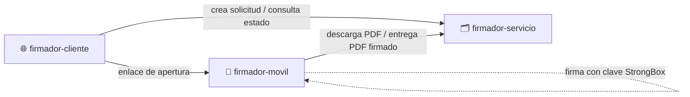
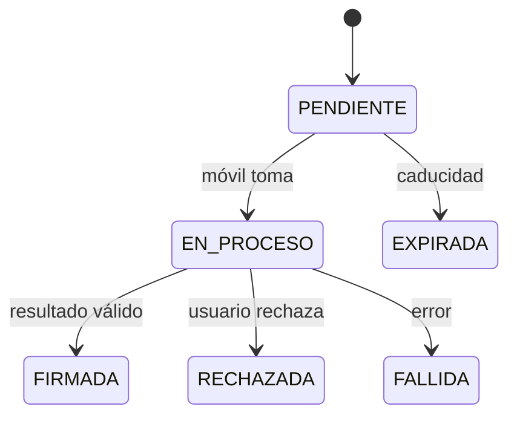

# 🗂️ Firmador servicio

Backend REST (NestJS) que **gestiona solicitudes de firma** entre la web (`firmador-cliente`) y el teléfono (`firmador-movil`). Representa el **sistema de gestión documental de ejemplo** de la monografía, el escenario de una entidad usuaria como AGETIC con su Sistema de Plantillas.

> ⚠️ **Prueba de concepto, prioridad P2.** No posee claves, no firma, no emite certificados y **no** representa al servicio de certificación de la ECA.

## 🧩 Lugar en el ecosistema

## ✅ Responsabilidades

- Crear solicitudes con identificador opaco, SHA-256 del PDF y caducidad.
- Entregar el PDF solo al móvil autorizado y recibir el PDF firmado sin sobrescribir el original.
- Controlar los estados, impedir repeticiones y exponer el estado al cliente.
- Registrar eventos sin datos sensibles.

## 🔄 Estados

## 🎯 Aporte a la monografía

Permite evaluar el requisito **RF07** (solicitudes desde un sistema documental). Si no se completa a tiempo, se informa como **no evaluado** y la evaluación principal no cambia.

## 🚫 No hace

Generar claves, firmar, actuar como CA, sustituir la validación criptográfica independiente ni autorizar una firma solo porque alguien conoce el ID.

📄 Detalle: [Especificaciones técnicas](docs/ESPECIFICACIONES_TECNICAS.md)
