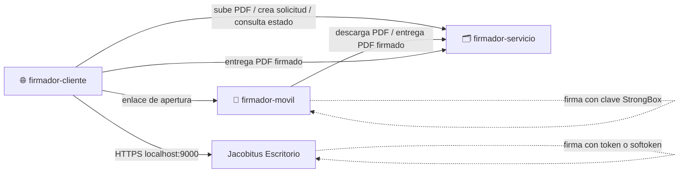
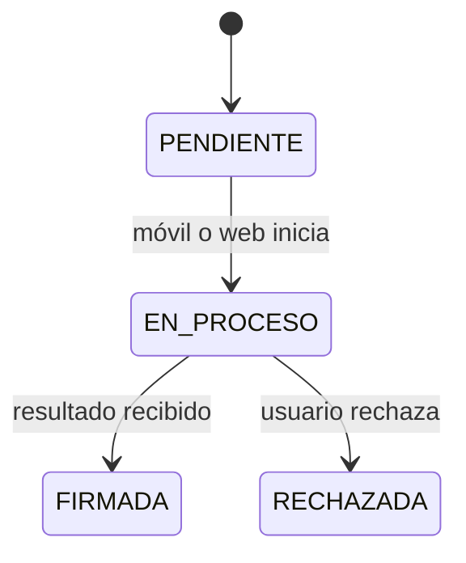

# 🗂️ Firmador servicio

Backend Express que **guarda documentos y gestiona solicitudes de firma** entre la web (`firmador-cliente`), el teléfono (`firmador-movil`) y Jacobitus Escritorio. Junto con la web, representa el **sistema de gestión documental de ejemplo** de la monografía: el escenario de una entidad usuaria como AGETIC con su Sistema de Plantillas.

> ⚠️ **Prueba de concepto, prioridad P2.** No posee claves, no firma, no emite certificados y **no** representa al servicio de certificación de la ECA. Solo cubre los casos ideales.

## 🧩 Lugar en el ecosistema

## ✅ Responsabilidades

- Guardar los documentos; cada firma reemplaza el PDF por la versión firmada.
- Crear solicitudes con identificador opaco y SHA-256 del PDF, y controlar sus estados.
- Entregar el PDF al móvil y recibir su resultado; recibir también el PDF que firma la web con Jacobitus.
- Leer titular, emisor y fecha declarada de cada firma para mostrarlos en la web.
- Aceptar peticiones de la web desde su origen configurado (CORS); la API escucha en el puerto 3000, por IP o dominio.

## 🔄 Estados

## 🎯 Aporte a la monografía

Permite evaluar el requisito **RF07** (solicitudes desde un sistema documental). Si no se completa a tiempo, se informa como **no evaluado** y la evaluación principal no cambia.

## 🚫 No hace

Generar claves, firmar, actuar como CA, validar firmas con efectos legales ni autorizar una firma solo porque alguien conoce el ID.

📄 Detalle: [Especificaciones técnicas](docs/ESPECIFICACIONES_TECNICAS.md)
