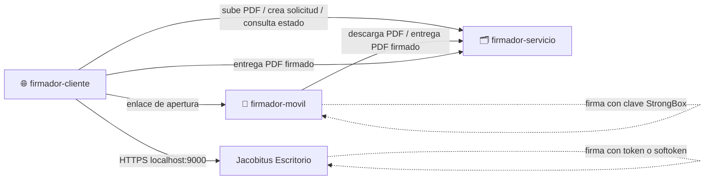
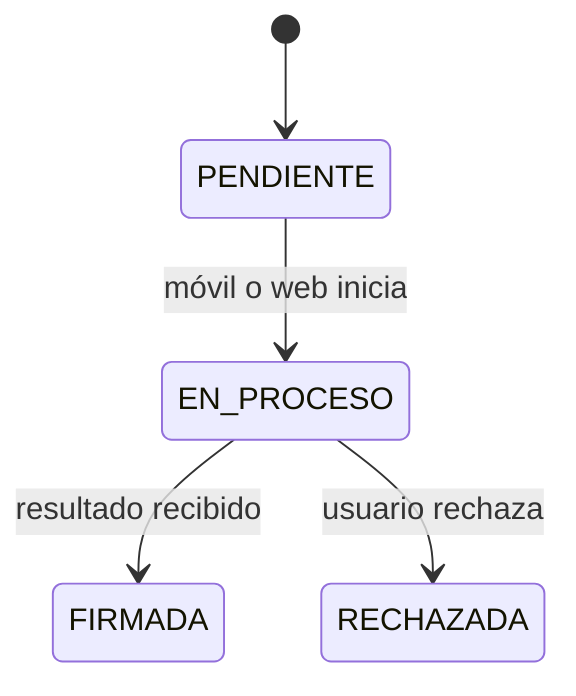

# 🗂️ Firmador servicio

Backend Express que **guarda documentos y gestiona solicitudes de firma** entre la web (`firmador-cliente`), el teléfono (`firmador-movil`) y Jacobitus Escritorio.

> ⚠️ **Prueba de concepto académica.** No posee claves, no firma, no emite certificados y **no** representa al servicio de certificación de la ECA. Solo cubre los casos ideales.

## 🎓 Contexto

Parte de la prueba de concepto de la monografía *Estrategias basadas en PMBOK 7 con un enfoque adaptativo para la incorporación de dispositivos móviles en el servicio de firma digital de la Entidad Certificadora Pública AGETIC, orientadas a la entrega de valor al cliente* (Maestría en Transformación Digital y Gestión de Proyectos Tecnológicos, Universidad Mayor de San Andrés, 2026). Junto con la web [`firmador-cliente`](https://github.com/AlexQuispe/firmador-cliente), forma el sistema de gestión documental de ejemplo con el que se probó que [`firmador-movil`](https://github.com/AlexQuispe/firmador-movil) puede atender firmas solicitadas desde otro sistema: el escenario de una entidad usuaria, como AGETIC con su Sistema de Plantillas.

## 🧩 Lugar en el ecosistema

## ✅ Responsabilidades

- Guardar los documentos; cada firma reemplaza el PDF por la versión firmada.
- Crear solicitudes con identificador opaco y SHA-256 del PDF, y controlar sus estados.
- Entregar el PDF al móvil y recibir su resultado; recibir también el PDF que firma la web con Jacobitus.
- Leer titular, emisor y fecha declarada de cada firma para mostrarlos en la web.
- Aceptar peticiones de la web desde su origen configurado (CORS); la API escucha en el puerto 3000, por IP o dominio.

## 🔄 Estados

## ✅ Qué se comprobó

En la prueba de integración (25 de octubre de 2026), un Samsung Galaxy S23 Ultra con Android 16 y Chrome atendió tres solicitudes: la primera se firmó, la segunda se rechazó en el teléfono y la tercera agregó una segunda firma al documento de la primera. Las catorce comparaciones del SHA-256 entre lo que entregó el servicio, lo que firmó el teléfono y lo que guardó el servicio coincidieron; el rechazo no modificó el documento y la segunda firma no alteró la primera.

Es un sistema de ejemplo, no preparado para un uso real: la solicitud se atiende solo con su ID, sin clave de acceso ni vencimiento; el servicio acepta dos veces el mismo resultado; y la comunicación no está cifrada.

## 🏷️ Versión evaluada

| Prueba                            | Commit |
| --------------------------------- | ------ |
| Prueba de integración (iteración I5) | [`03c4b29`](https://github.com/AlexQuispe/firmador-servicio/tree/03c4b29e71acf531341a4f08be395c68da4cc7a8) |

Los cambios posteriores (solicitudes firmadas desde la web con Jacobitus Escritorio, CORS para varios orígenes y documentación) no se evaluaron en la monografía.

## 🚫 No hace

Generar claves, firmar, actuar como CA, validar firmas con efectos legales ni autorizar una firma solo porque alguien conoce el ID.

📄 Detalle: [Especificaciones técnicas](docs/ESPECIFICACIONES_TECNICAS.md) · 🛠️ [Manual de instalación](INSTALL.md) · 📜 [Licencia LPG-Bolivia v1.1](LICENSE)
