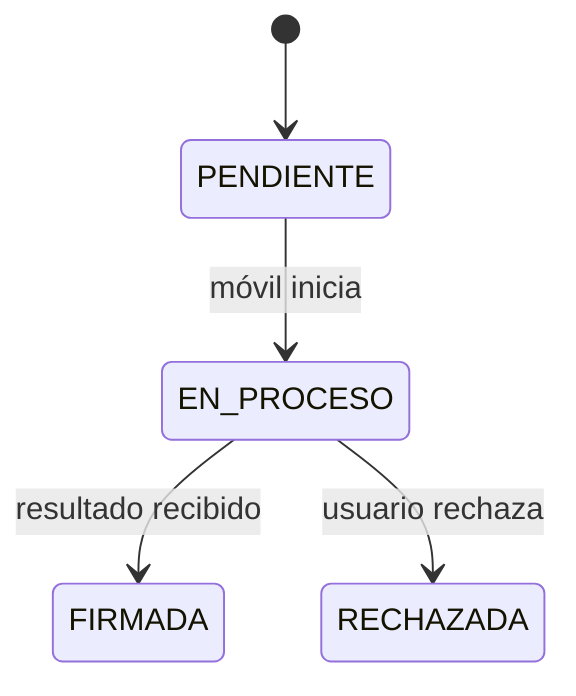

# Especificaciones técnicas — Firmador servicio

**Versión:** 0.5 · **Estado:** listo para implementar · **Prioridad:** P2 · **Trazabilidad:** requisito RF07 y criterio V5 de la monografía (apartados 3.2.2 y 3.2.6).

## 1. Alcance y contexto

Servicio HTTP que guarda los documentos, gestiona las solicitudes de firma entre la web y el móvil, y extrae los datos de las firmas. La web (`firmador-cliente`) se sirve aparte en el puerto 8080 y llama a esta API en el 3000. Ambos corren en el mismo equipo (la laptop o un servidor con dominio) y el teléfono llega a ellos por IP o dominio. No ejecuta operaciones con claves privadas.

Simplificaciones de la PoC (declaradas, no aptas para producción):

- ✅ Solo casos ideales: sin validación de entradas ni manejo detallado de errores.
- 🔓 Ni la web ni el móvil se autentican ante la API. El usuario de la sesión simulada llega en la cabecera `X-Usuario`. El móvil opera la solicitud solo con su ID, un UUID v4 aleatorio que viaja en el enlace. No se compila ningún secreto en la app: quedaría al alcance de cualquiera con el APK. La firma la autoriza el titular en el teléfono (confirmación y autenticación del Keystore), y el firmante se lee del certificado del PDF.
- 💾 Los documentos, los PDF y las solicitudes se conservan entre reinicios y recreaciones del servicio. El mecanismo de almacenamiento no forma parte de esta especificación.
- 🔁 La web consulta el estado al volver del teléfono o a pedido del usuario; sin consultas periódicas ni notificaciones push.
- 🌐 HTTP por IP en la red local; HTTPS solo si se despliega con dominio. Sin App Link verificado.
- 🔀 CORS permitido solo para `ORIGEN_CLIENTE`, con las cabeceras `X-Usuario`, `X-Nombre-Archivo` y `Content-Type` (la subida usa `application/pdf`, que requiere verificación previa).

Configuración por variables de entorno: `PUERTO` (3000), `ORIGEN_CLIENTE` (origen exacto de la web, p. ej. `http://192.168.1.10:8080` o `https://<dominio>`) y `DIR_DATOS` (directorio de los datos persistentes). El servicio escucha en todas las interfaces para que el teléfono lo alcance.

## 2. Modelo

- **Documento:** `id`, `nombre`, `tamano`, `sha256`, `subidoPor`, `subidoEn`, `firmas`, `solicitudActual`. Un solo PDF por documento, que cada firma reemplaza.
- **Solicitud:** `id` (UUID), `documentoId`, `sha256` (del PDF entregado al móvil), `sha256Resultado` (del PDF firmado recibido), `solicitadoPor`, `estado`, `eventos` (estado y hora).
- **Firma:** `titular` (CN del sujeto), `emisor` (CN del emisor), `serie`, `vigenciaDesde`, `vigenciaHasta`, `fechaDeclarada` (`/M` del diccionario de firma) y `subFilter`.



## 3. API

| Método | Ruta                               | Actor | Propósito                                                                                             |
| ------ | ---------------------------------- | ----- | ----------------------------------------------------------------------------------------------------- |
| GET    | `/api/estado`                      | Todos | Estado del servicio                                                                                   |
| GET    | `/api/documentos`                  | Web   | Lista con estado y última firma                                                                       |
| POST   | `/api/documentos`                  | Web   | Subir PDF: cuerpo `application/pdf`, nombre en `X-Nombre-Archivo` codificado con `encodeURIComponent` |
| GET    | `/api/documentos/{id}`             | Web   | Metadatos, firmas y solicitud actual con eventos                                                      |
| GET    | `/api/documentos/{id}/archivo`     | Web   | PDF actual                                                                                            |
| POST   | `/api/documentos/{id}/solicitudes` | Web   | Crear solicitud sobre el PDF actual                                                                   |
| GET    | `/api/solicitudes/{id}`            | Web   | Estado                                                                                                |
| POST   | `/api/solicitudes/{id}/iniciar`    | Móvil | `PENDIENTE` → `EN_PROCESO`; devuelve nombre y SHA-256                                                 |
| GET    | `/api/solicitudes/{id}/documento`  | Móvil | PDF a firmar                                                                                          |
| POST   | `/api/solicitudes/{id}/resultado`  | Móvil | PDF firmado como cuerpo `application/pdf`                                                             |
| POST   | `/api/solicitudes/{id}/rechazo`    | Móvil | Registrar rechazo                                                                                     |

Las rutas del móvil no piden credenciales; la solicitud se identifica por su ID. Las rutas de la web responden JSON, salvo `/archivo`.

**Estado del documento** (campo `estado` en la lista y el detalle), calculado por el servicio:

| `estado`    | Condición                                                     |
| ----------- | ------------------------------------------------------------- |
| `EN_CURSO`  | La solicitud actual está en `PENDIENTE` o `EN_PROCESO`        |
| `RECHAZADA` | La solicitud actual está en `RECHAZADA`                       |
| `FIRMADO`   | Sin solicitud en curso ni rechazada, y con al menos una firma |
| `SIN_FIRMA` | Sin solicitud y sin firmas                                    |

`GET /api/estado`: responde `200` si el servicio está en marcha y puede leer sus datos. Sirve para comprobar desde el teléfono o el despliegue que la API es alcanzable, y para comparar la hora del servicio, que es la de los eventos, con la del equipo que registra la evidencia.

```json
{ "estado": "OK", "hora": "2026-10-25T14:00:00Z" }
```

`GET /api/documentos`: lista de documentos.

```json
[
  {
    "id": "uuid",
    "nombre": "informe.pdf",
    "tamano": 182345,
    "subidoPor": "operador",
    "subidoEn": "2026-10-25T14:02:00Z",
    "estado": "FIRMADO",
    "cantidadFirmas": 1,
    "ultimaFirma": { "titular": "CN del sujeto", "fechaDeclarada": "2026-10-25T14:05:00Z" }
  }
]
```

`ultimaFirma` es `null` si no hay firmas.

`POST /api/documentos`: responde con el documento creado, con la misma forma que un elemento de la lista. El servicio decodifica `X-Nombre-Archivo` con `decodeURIComponent`.

`GET /api/documentos/{id}`: detalle.

```json
{
  "id": "uuid",
  "nombre": "informe.pdf",
  "tamano": 182345,
  "sha256": "hex",
  "subidoPor": "operador",
  "subidoEn": "2026-10-25T14:02:00Z",
  "estado": "FIRMADO",
  "firmas": [
    {
      "titular": "CN del sujeto",
      "emisor": "CN del emisor",
      "serie": "hex",
      "vigenciaDesde": "2026-10-01T00:00:00Z",
      "vigenciaHasta": "2027-10-01T00:00:00Z",
      "fechaDeclarada": "2026-10-25T14:05:00Z",
      "subFilter": "ETSI.CAdES.detached"
    }
  ],
  "solicitudActual": {
    "id": "uuid",
    "estado": "FIRMADA",
    "solicitadoPor": "operador",
    "eventos": [
      { "estado": "PENDIENTE", "hora": "2026-10-25T14:03:00Z" },
      { "estado": "EN_PROCESO", "hora": "2026-10-25T14:04:00Z" },
      { "estado": "FIRMADA", "hora": "2026-10-25T14:05:10Z" }
    ]
  }
}
```

`firmas` va de la más antigua a la más reciente y `eventos` en orden cronológico. `solicitudActual` es `null` si nunca se pidió una firma.

`GET /api/documentos/{id}/archivo`: el PDF actual, con `Content-Type: application/pdf` y `Content-Disposition: attachment; filename="<nombre>"`. La web lo abre con un enlace a otro origen, donde Chrome ignora el atributo `download`; sin esta cabecera podría mostrar el PDF en lugar de descargarlo.

`POST /api/documentos/{id}/solicitudes` (ejemplo de respuesta):

```json
{
  "id": "uuid",
  "estado": "PENDIENTE",
  "sha256Documento": "hex",
  "enlaceAplicacion": "firmadormovil://firmar/uuid"
}
```

`GET /api/solicitudes/{id}`:

```json
{ "id": "uuid", "documentoId": "uuid", "estado": "EN_PROCESO" }
```

`POST /api/solicitudes/{id}/iniciar`:

```json
{ "id": "uuid", "nombre": "informe.pdf", "sha256": "hex" }
```

`POST /api/solicitudes/{id}/resultado` y `POST /api/solicitudes/{id}/rechazo`:

```json
{ "id": "uuid", "estado": "FIRMADA" }
```

Las rutas que crean un documento o una solicitud responden `201`; el resto, `200`.

El enlace solo lleva el ID. Al ser un _deep link_ sin verificación, se declara como solución provisional, no equivalente a un App Link.

## 4. Extracción de firmas

Al recibir el resultado:

1. Reemplazar el PDF del documento y actualizar su `sha256`. Es una regla de negocio de este sistema de ejemplo, no del firmador móvil, que solo devuelve el resultado; otro sistema documental podría conservar las versiones. No se conserva una copia aparte del original: la firma incremental mantiene intactos los bytes anteriores y su `ByteRange` los cubre, y el SHA-256 de lo entregado al móvil queda en la solicitud.
2. Leer cada firma del PDF recibido: `/M` y `/SubFilter` de su diccionario, y titular, emisor, serie y vigencia del certificado del firmante incluido en el CMS de `/Contents`.
3. Reemplazar `firmas` del documento por las extraídas. Como el móvil firma con guardado incremental, el PDF nuevo contiene también las firmas anteriores.

Es una lectura de datos para mostrarlos en la web, **no una validación**: no comprueba integridad, cadena ni revocación. La evaluación formal (K1) usa validadores independientes. La comprobación de integridad (resumen del `ByteRange` contra el atributo `messageDigest`) queda como mejora.

## 5. Requisitos

| ID    | Requisito                                                      | Prioridad | Verificación                      |
| ----- | -------------------------------------------------------------- | --------- | --------------------------------- |
| FS-01 | Guardar documentos con su SHA-256 y listarlos                  | P2        | Lista tras subir un PDF           |
| FS-02 | Crear solicitudes sobre el PDF actual de un documento          | P2        | Respuesta con ID y enlace         |
| FS-03 | Identificar las solicitudes con UUID v4 sin exponer su lista   | P2        | Revisión de código                |
| FS-04 | Aplicar las transiciones del §2                                | P2        | Flujo completo                    |
| FS-05 | Reemplazar el PDF por el firmado y registrar ambos SHA-256     | P2        | Hashes en documento y solicitud   |
| FS-06 | Extraer titular, emisor y fecha declarada de cada firma        | P2        | Comparación con el certificado    |
| FS-07 | Registrar la hora de cada evento sin secretos ni contenido PDF | P2        | Revisión de datos y consola       |
| FS-08 | Validaciones, caducidad y bloqueo de repeticiones              | P3        | Casos inválidos                   |
| FS-09 | Comprobar la integridad de cada firma                          | P3        | Comparación con validador externo |
| FS-10 | Conservar documentos y solicitudes tras reiniciar el servicio  | P2        | Lista igual tras reiniciar        |
| FS-11 | Informar el estado del servicio                                | P2        | `curl` a `/api/estado`            |

## 6. Evaluación

Aporta evidencia descriptiva para RF07 y V5: solicitudes completadas extremo a extremo y tiempo desde la creación hasta el resultado, separando la espera del usuario. Los indicadores formales los fija la monografía en el apartado 3.2.6.

## 7. Fuera de alcance

Gestión real de identidades, autenticación de la web, HTTPS, App Links verificados, colas, push, validación criptográfica con efectos legales y producción.
